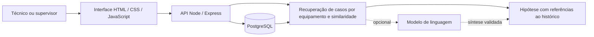
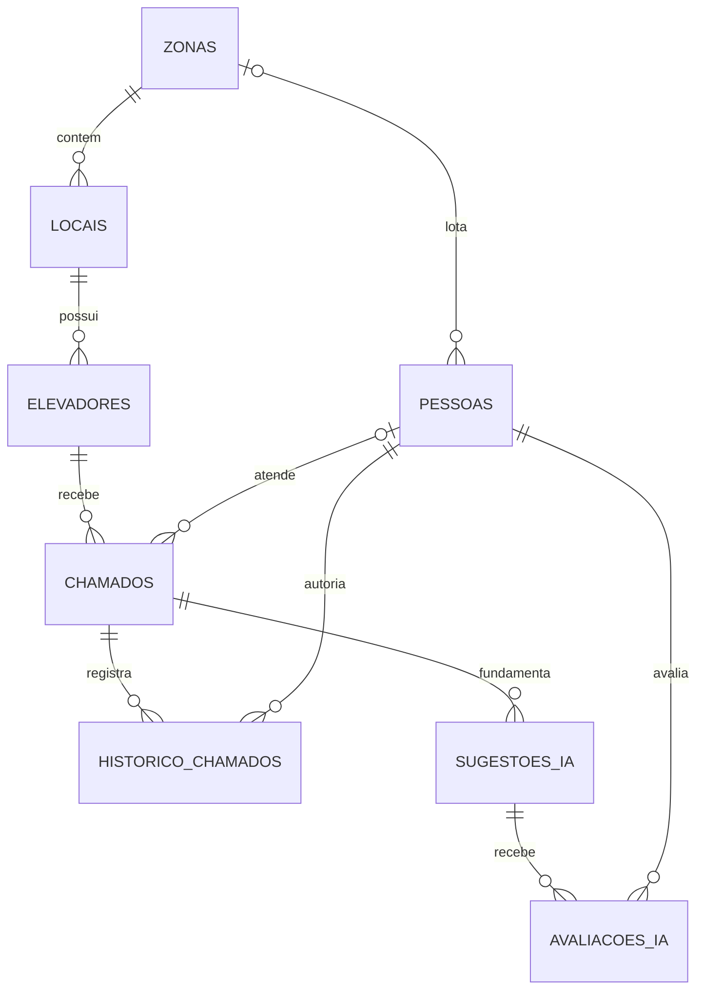

# Arquitetura e identificação de recorrências do FieldIQ

## Arquitetura para explicar



A interface exibe os dados; a API autentica e autoriza cada operação; o banco persiste os registros e calcula métricas. A análise recupera evidências e apresenta uma hipótese. A identificação de recorrências é local e não usa LLM.

O modo local executa o PostgreSQL embutido do PGlite e guarda os arquivos no disco do servidor. Para mostrar um serviço PostgreSQL separado em pgAdmin/DBeaver, há configuração Docker opcional e suporte a DATABASE_URL.

## Modelo de dados



Também existem sessões. A importação de dados não integra o escopo atual. A relação do técnico com o chamado é opcional até a atribuição; a relação de todo chamado com um elevador é obrigatória.

## Fluxo da apresentação

1. Inicie o servidor na raiz do repositório e abra http://127.0.0.1:4173.
2. Entre como **supervisor.capital** e mostre o dashboard. Explique que resolução, tempos e SLA são calculados; um atendimento fora do prazo não recebe SLA cumprido por ter sido encerrado.
3. Em **Elevadores e Locais**, mostre BAR-001 e BAR-002 no mesmo condomínio. Estar no mesmo bairro não significa ser o mesmo equipamento.
4. Em **Banco de Dados**, selecione elevadores, chamados e histórico. Mostre as chaves estrangeiras no SQL e exporte os dados da região.
5. Saia e entre como **tecnico.capital**. Abra o chamado **#5** e mostre as quatro ocorrências anteriores de BAR-001.
6. Expanda as evidências e abra um dos chamados anteriores. Explique a diferença entre um fato documentado e uma hipótese para o atendimento atual.
7. Volte ao #5, abra a aba **Atendimento**, registre uma solução fictícia, selecione **Resolvido** e salve. A aba **Histórico** mostra as alterações e sua autoria.
8. Recarregue a página: a sessão, a solução e o histórico permanecem.
9. Mostre um chamado atribuído a outro técnico: o formulário de alteração não aparece. A API também bloqueia a tentativa, mesmo que alguém modifique o HTML.
10. Entre como técnico do Interior: os chamados da Capital não são retornados pelo servidor.

O #5 passa a ficar resolvido após essa demonstração. Para repeti-la, o supervisor pode reabri-lo; não é necessário apagar o banco. A reabertura limpa a data de resolução e recalcula o prazo a partir da abertura original, sem zerar o relógio do SLA.

## Consultas para mostrar no banco

```sql
SET search_path TO fieldiq, public;

-- Identidade do equipamento e local.
SELECT e.codigo, l.nome, l.bairro, z.regiao
FROM elevadores e
JOIN locais l ON l.id = e.local_id
JOIN zonas z ON z.id = l.zona_id;

-- Todos os atendimentos de um equipamento.
SELECT id, titulo, status, aberto_em, resolvido_em, solucao
FROM vw_chamados_metricas
WHERE elevador_codigo = 'BAR-001'
ORDER BY aberto_em;

-- SLA calculado a partir do prazo e das datas.
SELECT id, sla_horas, sla_cumprido, sla_vencido, tempo_resolucao_min
FROM vw_chamados_metricas;

-- Autoria do histórico.
SELECT h.chamado_id, p.nome, h.alteracao, h.data
FROM historico_chamados h
JOIN pessoas p ON p.matricula = h.usuario_matricula
ORDER BY h.data DESC;
```

## Como explicar a análise local

O texto é normalizado, recebe pesos TF-IDF e é comparado por similaridade de cosseno. Termos de componentes complementam a recuperação. O sistema dá prioridade a casos do mesmo elevador e recupera somente registros anteriores e da zona autorizada.

O intervalo médio mede a distância temporal entre registros semelhantes anteriores. Ele não prevê a próxima falha. A contagem de soluções repetidas não mede taxa de sucesso clínico/técnico nem confirma causalidade. Não se apresenta o escore textual como confiança diagnóstica.

A implementação atual usa somente identificação local de recorrências, com referências aos chamados anteriores. O técnico avalia as condições atuais e outras causas; a indicação não representa uma solução confirmada.

## Escopo e limites desta versão

- Os dados iniciais são fictícios e indicados como demonstração.
- O sistema registra chamados e apoia a consulta do histórico; não comanda elevadores.
- Não há integração efetiva com ERP, telemetria ou sensores do equipamento.
- O técnico deve registrar o diagnóstico e a solução realmente aplicados para enriquecer o histórico.
- A recuperação por TF-IDF é uma base explicável para o TCC; uma avaliação com dados reais é necessária para medir qualidade e calibrar os limiares.
- O PostgreSQL hospedado exige configuração própria; a validação registrada foi local.
